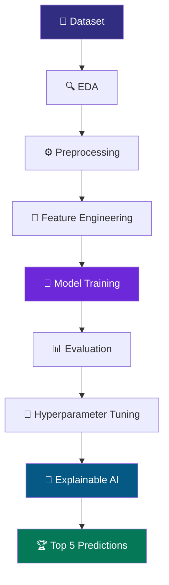

<!-- ANIMATED HEADER -->
<div align="center">


<a href="https://github.com/YOUR-ORG">

</a>

**UNIVERSITY OF HERTFORDSHIRE**

MSc Data Science with Advanced Research | 2026

[](https://python.org)
[](https://colab.research.google.com/)
[](https://github.com/)
[](https://scikit-learn.org/)
[](https://github.com/)

</div>

---

## ✨ 01. About the Challenge

> Data is everywhere. Intelligence comes from understanding it.

Welcome to our collaborative Data Science Challenge!

We are a team of MSc Data Science students exploring an unknown dataset, discovering hidden patterns and developing machine learning models to solve a predictive challenge.

Our goal is to build a reliable, explainable and high-performing solution through experimentation and teamwork.

## ⚡ 02. Our Mission

<div align="center">

| 🔍 DISCOVER | ⚙️ ENGINEER | 🤖 PREDICT |
|:---:|:---:|:---:|
| Explore the data | Prepare features | Train models |
| 📊 ANALYSE | 🧬 EXPLAIN | 🏆 OPTIMISE |
| Evaluate results | Understand predictions | Find the best solution |

</div>

## 🧠 03. The Machine Learning Pipeline



## 👥 04. Meet Our Team

| Member | Role | GitHub |
|:---|:---|:---|
| Member 01 | Team Coordinator | sahithreddypundru |
| Member 02 | Data Exploration | @sriloki4887|
| Member 03 | Data Preprocessing | @abineshraw1998 |
| Member 04 | Feature Engineering | @sapavat Athira |
| Member 05 | Model Development | @sadweep03|
| Member 06 | Model Optimisation | @vishnu181-max|
| Member 07 | Model Evaluation | @Dharanidhar Beere |
| Member 08 | Explainable AI | @waleedabd10 |
| Member 09 | Visualisation & Presentation | @username |

## 🛠️ 05. Technology Universe

<div align="center">


</div>

**Libraries and frameworks**

`Pandas` `NumPy` `Scikit-learn` `XGBoost` `Matplotlib` `Seaborn` `SHAP`

## 📊 06. Exploratory Data Analysis

Our first step is to understand the dataset before building predictive models.

- Dataset structure and statistical summaries.
- Missing values and duplicates.
- Numerical and categorical distributions.
- Correlation and feature relationships.
- Outlier detection.
- Target variable analysis.

<div align="center">

**DATA EXPLORATION → PATTERN DISCOVERY → INSIGHTS**

</div>

## 🤖 07. Model Laboratory

We will experiment with different algorithms based on the challenge requirements.

| Model | Experiment |
|:---|:---|
| Logistic Regression | Baseline |
| Decision Tree | Tree-based learning |
| Random Forest | Ensemble learning |
| SVM | Classification |
| Gradient Boosting | Boosted learning |
| XGBoost | Advanced optimisation |

## 🎯 08. Performance Dashboard

Our models will be evaluated using the task-specific metric identified during the hackathon.

| Model | Validation Score | Status |
|:---|---:|:---|
| Model 01 | TBD | ⏳ |
| Model 02 | TBD | ⏳ |
| Model 03 | TBD | ⏳ |
| Model 04 | TBD | ⏳ |
| Model 05 | TBD | ⏳ |

## 🧬 09. Explainable AI

We believe a good model should not only make predictions but also explain them.

Our XAI experiments will investigate:

- SHAP summary plots.
- Feature importance.
- SHAP dependence plots.
- Individual prediction explanations.
- Model interpretation and comparison.

## 🏆 10. Final Predictions

Our five best model configurations will be ranked and submitted for evaluation.

```text
predictions/
│
├── prediction_1.csv  # 🥇 Best
├── prediction_2.csv  # 🥈 Second
├── prediction_3.csv  # 🥉 Third
├── prediction_4.csv  # Fourth
└── prediction_5.csv  # Fifth
```

## 📁 11. Project Architecture

```text
DATA-SCIENCE-CHALLENGE/
│
├── README.md
├── notebooks/
├── data/
├── models/
├── predictions/
├── visualisations/
└── presentation/
```

## 🤝 12. Collaboration

Our team uses GitHub and Google Colab to maintain a transparent and collaborative workflow.

- Shared notebook development.
- Git commits and version control.
- Task delegation.
- Group discussions.
- Model comparison.
- Peer feedback.

<details>
<summary><b>📌 View our collaboration guidelines</b></summary>

1. Communicate before making major changes.
2. Use meaningful commit messages.
3. Keep notebooks organised.
4. Document preprocessing and modelling decisions.
5. Review code collaboratively.
6. Ensure every member understands the overall project.

</details>

## 📅 13. Challenge Timeline

- **11 November 2026:** Hackathon and model development.
- **11 November 2026:** Prediction submission.
- **17 November 2026:** Presentation submission.
- **17 November 2026:** Professional discussion.

## 🎓 14. Academic Details

| Information | Details |
|:---|:---|
| University | University of Hertfordshire |
| Programme | MSc Data Science with Advanced Research |
| Tutor | Anastasia Ponomareva |
| Challenge | Data Science Challenge 2026 |
| Hackathon | 11 November 2026 |

---

<div align="center">


### 🚀 EXPLORE. EXPERIMENT. EVALUATE. EXPLAIN.

**Turning Data into Intelligence.**

University of Hertfordshire | 2026

</div>
